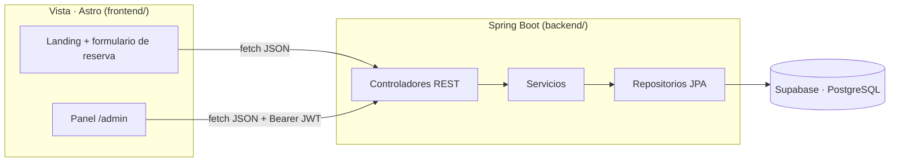
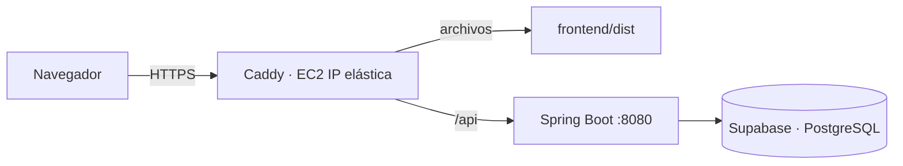

# Sakura · Gestión de pedidos y reservas para restaurante

Sistema de gestión de pedidos para un restaurante japonés (ficticio): menú con categorías y productos, mesas, pedidos
con detalle y total automático, usuarios con roles (Administrador, Mesero, Cliente) y, como extra, una landing con
**recorrido por el local que avanza con el scroll** y **reservas online**.

Proyecto de clase de **Desarrollo de Aplicaciones Empresariales** (UTS, II-2026). Arquitectura de 3 capas / MVC:
**Spring Boot** (API REST con **JWT**), **PostgreSQL en Supabase** y frontend en **Astro** (JavaScript/TypeScript).
Requerimientos y justificación: documento del Sprint 1. Diseño, capas y revisión de la arquitectura en
[`docs/arquitectura.md`](docs/arquitectura.md).

## Entregables

| Entregable | Dónde |
|---|---|
| Fuentes del proyecto | Este repositorio: https://github.com/DAE2026-2/sakura |
| Documento guía (este README) | Cómo se instala, se usa y se prueba |
| Backend en Spring Boot | [`backend/`](backend) |
| Frontend | [`frontend/`](frontend) — en **Astro** en lugar de React (ver [`docs/arquitectura.md`](docs/arquitectura.md#por-qué-astro-y-no-react)) |
| Script de la base de datos | [`database/supabase.sql`](database/supabase.sql) |
| DER (diagrama entidad-relación) | [`docs/base-de-datos.md`](docs/base-de-datos.md) |

## Equipo

| Integrante | Módulo | CRUD |
|---|---|---|
| Johann Sebastian Castellanos Prada ([@sebastiancastellanos3](https://github.com/sebastiancastellanos3)) | Mesas, pedidos, usuarios y reservas | Mesas, Pedidos (con detalle), Usuarios |
| Angel Santiago Jaimes Moreno ([@angelsantiagoa2j2](https://github.com/angelsantiagoa2j2)) | Menú | Categorías, Productos |

Las historias de usuario están en los **Issues** del repositorio y en el tablero del **Project**, y resumidas en
[`docs/historias-de-usuario.md`](docs/historias-de-usuario.md).

## Arquitectura



| Capa MVC | Dónde | Qué hace |
|---|---|---|
| **Modelo** | `backend/src/main/java/com/sakura/model`, `repository` | Entidades JPA y acceso a datos |
| **Controlador** | `backend/src/main/java/com/sakura/controller`, `service` | API REST y reglas de negocio |
| **Vista** | `frontend/src` | Páginas Astro que consumen la API |

```text
sakura/
├── backend/                 Spring Boot 4.1 · Java 21
│   └── src/main/java/com/sakura/
│       ├── model/           Usuario, Categoria, Producto, Mesa, Pedido, DetallePedido, Reserva, Turno…
│       ├── repository/      Spring Data JPA
│       ├── service/         Un servicio por módulo (reglas de negocio y transacciones)
│       ├── controller/      Controladores REST públicos y /api/admin
│       ├── dto/             Peticiones y respuestas (records con validación)
│       ├── exception/       Errores de negocio y respuestas de error en JSON
│       └── config/          Seguridad (JWT y roles), CORS y propiedades
├── frontend/                Astro 7 · Tailwind 4 · GSAP · Lenis
│   └── src/
│       ├── pages/           index (landing) y panel /admin
│       ├── components/      Secciones de la landing y marco del panel
│       ├── scripts/         Recorrido con scroll, formulario de reserva, panel
│       └── lib/api.ts       Cliente de la API
├── database/supabase.sql    Esquema, seguridad y datos de ejemplo
└── docs/                    Diseño de la base de datos e historias de usuario
```

## Base de datos

Diseño completo y diagrama entidad-relación en [`docs/base-de-datos.md`](docs/base-de-datos.md).

Para crearla en Supabase: **SQL Editor → New query**, pega [`database/supabase.sql`](database/supabase.sql) y **Run**.

## Puesta en marcha

Necesitas **Java 21+** y **Node 22+**.

### 1. Backend (puerto 8080)

```sh
cd backend
./mvnw spring-boot:run
```

Arranca con una base de datos H2 en memoria y datos de ejemplo, sin configurar nada. Para usar Supabase:

```sh
cp .env.example .env        # rellena la conexión del Session pooler (Supabase → Connect) y JWT_SECRET
./mvnw spring-boot:run -Dspring-boot.run.profiles=supabase
```

`JWT_SECRET` es la clave con la que se firman los tokens (mínimo 32 caracteres): `openssl rand -base64 48`.
En local no hace falta, el perfil `local` trae una de desarrollo. Sin ella, el perfil `supabase` no arranca.

### 2. Frontend (puerto 4321)

```sh
cd frontend
npm install
npm run dev
```

- Landing: http://localhost:4321
- Iniciar sesión: http://localhost:4321/login (cada rol va a su pantalla; usuarios de prueba más abajo)
- Panel: http://localhost:4321/admin (admin@sakura.example / sakura123)
- Vídeos del recorrido (opcional): `sh scripts-dev/descargar-videos.sh`

## Cómo se usa (paso a paso)

**En línea:** https://34-204-83-119.sslip.io (IP elástica `34.204.83.119`). En local: http://localhost:4321.

1. **Cliente sin cuenta**: abre la landing, pulsa *Reservar mesa*, elige fecha, hora y personas y envía. Guarda el
   código `SAK-XXXX`: con él y tu email puedes consultar o cancelar la reserva.
2. **Cliente con cuenta**: entra en `/login` (o crea una cuenta en *Crear cuenta*). Te lleva a `/mi-pedido`: elige
   mesa, añade platos de la carta y sigue el estado. Mientras está pendiente puedes cambiarlo o cancelarlo.
3. **Mesero**: entra con `mesero@sakura.example`. En `/mesero` ves las mesas con su estado; toca una para abrir el
   pedido, añade productos, cambia el estado (en preparación → servido) y cóbralo para liberar la mesa.
4. **Administrador**: entra con `admin@sakura.example`. En `/admin` ves las reservas del día (cambiar mesa o estado)
   y desde el menú lateral gestionas categorías, productos, mesas, usuarios y el historial de ventas.
5. **Cerrar sesión**: botón *Cerrar sesión*.

## Despliegue en AWS (RNF-06)

Una EC2 `t3.micro` en **us-east-1** con **IP elástica** (no cambia aunque se reinicie). Dentro corren dos
contenedores Docker: el backend (Java 21, perfil `supabase`) y **Caddy**, que sirve el frontend compilado, envía
`/api` al backend y pone **HTTPS** automático con `sslip.io`. La base de datos **sigue en Supabase** (también en
us-east-1); no se migra.



Requisitos: AWS CLI con sesión (`aws login`), `backend/.env` relleno, Java 21+ y Node 22+.

```sh
sh deploy/aws-up.sh     # 1. crea key pair, security group (80/443 público, 22 solo tu IP), EC2 e IP elástica
sh deploy/aws-ship.sh   # 2. compila backend y frontend y los sube; imprime la URL. Repetir tras cada cambio
sh deploy/aws-down.sh   # 3. al terminar: borra instancia, IP elástica, security group y key pair (deja de cobrar)
```

- Coste aproximado: ~US$0,35/día con la instancia encendida (EC2 + IP elástica). Apagarla no libera la IP: usar `aws-down.sh`.
- Las páginas leen el menú **al compilar**: si cambias productos en el panel, vuelve a correr `aws-ship.sh` para que
  la landing lo muestre.
- Entrar al servidor: `ssh -i deploy/sakura-demo.pem ec2-user@<IP>`; registros del backend: `docker logs sakura-api`.

## API

| Método | Ruta | Descripción | Acceso | HU |
|---|---|---|---|---|
| GET | `/api/menu` | Menú: categorías con productos disponibles | Público | HU-06 |
| POST | `/api/auth/login` | Inicia sesión: devuelve el token JWT | Público | HU-07 |
| POST | `/api/auth/registro` | Registro de cliente | Público | HU-07 |
| GET | `/api/auth/yo` | Usuario autenticado y su rol | Autenticado | HU-07 |
| CRUD | `/api/admin/categorias` | Categorías | Admin | HU-02 |
| CRUD | `/api/admin/productos` | Productos | Admin | HU-01 |
| CRUD | `/api/admin/mesas` | Mesas | Admin | HU-08 |
| CRUD | `/api/admin/usuarios` | Usuarios y roles | Admin | HU-07 |
| GET · POST | `/api/pedidos` | Pedidos de una mesa | Mesero / Admin | HU-03 |
| CRUD | `/api/pedidos/{id}/detalles` | Detalle del pedido, total automático | Mesero / Admin | HU-04 |
| GET | `/api/admin/pedidos` | Historial con filtros | Admin | HU-05 |
| GET | `/api/disponibilidad` | Horas libres para reservar | Público | HU-09 |
| POST · GET · DELETE | `/api/reservas` | Reservas online | Público | HU-09 |
| GET · PATCH | `/api/admin/reservas` | Reservas del día | Admin | HU-09 |

Los errores siempre responden `{ "mensaje": "...", "campos": { "campo": "error" } }`.

## Cómo se usa la API (JWT)

1. **Iniciar sesión** con email y contraseña. Devuelve un token que dura 8 horas (`sakura.jwt.horas`):

   ```sh
   curl -X POST http://localhost:8080/api/auth/login \
     -H 'Content-Type: application/json' \
     -d '{"email":"admin@sakura.example","password":"sakura123"}'
   # {"token":"eyJhbGciOiJIUzI1NiJ9...","usuario":{"id":1,"nombre":"Administrador","rol":"ADMIN",...}}
   ```

2. **Enviar el token** en cada petición protegida:

   ```sh
   TOKEN=eyJhbGciOiJIUzI1NiJ9...
   curl http://localhost:8080/api/admin/usuarios -H "Authorization: Bearer $TOKEN"
   ```

3. **Respuestas**: sin token o con token caducado/alterado → `401`; con token de un rol sin permiso → `403`.
4. **Cerrar sesión**: el frontend borra el token. El servidor no guarda sesiones; además, en cada petición vuelve a
   leer el usuario de la base, así que si un administrador lo **desactiva o le cambia el rol**, el token viejo deja de
   valer o pierde permisos al momento.

En Postman: pestaña *Authorization* → *Bearer Token* y pega el token.

## Pruebas

```sh
cd backend
./mvnw test
```

24 pruebas automáticas contra la base H2 en memoria (no tocan Supabase):

| Archivo | Qué prueba |
|---|---|
| `SeguridadJwtTests` | Login correcto e incorrecto, token en `/auth/yo`, HTTP Basic ya no sirve, token alterado, permisos de cada rol (200/401/403), usuario desactivado, registro |
| `CrudEndpointsTests` | CRUD completo por HTTP de categorías, productos, mesas y usuarios; errores de validación por campo; pedido completo del mesero (total automático, mesa ocupada y liberada, ventas en el historial); formato del contenido público |
| `MesasReservadasTests` | Mesa asignada a cada reserva, mesa reservada para el cliente y el mesero, cambio de mesa, cupo del turno al reactivar, un pedido por cliente, el cliente que reservó usa su mesa, no asignar mesas ocupadas, una reserva por email y día |
| `BackendApplicationTests` | La aplicación arranca |

## Usuarios de prueba

Los crea `database/supabase.sql` (y `data-local.sql` en local). Las contraseñas se guardan cifradas con BCrypt.

| Rol | Email | Contraseña | Puede |
|---|---|---|---|
| Administrador | `admin@sakura.example` | `sakura123` | Todo el panel: menú, mesas, usuarios, historial, reservas y pedidos |
| Mesero | `mesero@sakura.example` | `mesero123` | Pantalla `/mesero`: abrir pedidos, añadir productos, cambiar estado y cobrar |
| Cliente | `cliente@sakura.example` | `cliente123` | Pantalla `/mi-pedido`: elegir mesa, pedir desde la carta y seguir el estado; modificar o cancelar solo mientras está pendiente |

Los clientes nuevos se registran con `POST /api/auth/registro`; meseros y administradores los crea un administrador
en `/admin/usuarios`.

## Pantallas

| Ruta | Para | Qué hace |
|---|---|---|
| `/` | Clientes | Landing, menú disponible y reservas |
| `/login` | Todos | Iniciar sesión o crear cuenta de cliente; lleva a cada rol a su pantalla |
| `/mi-pedido` | Cliente | Hacer y seguir su pedido desde la mesa |
| `/mesero` | Mesero / Admin | Mesas con su estado y pedido de cada mesa con total automático |
| `/admin/mesas` | Admin | CRUD de mesas |
| `/admin/historial` | Admin | Historial de pedidos con filtros y ventas pagadas |
| `/admin/usuarios` | Admin | CRUD de usuarios y roles |
| `/admin` | Admin | Reservas del día |

## Reglas de negocio principales

- El total del pedido es siempre la suma de los subtotales del detalle; el precio se copia del producto al añadirlo.
- La mesa pasa a OCUPADA al abrir un pedido y vuelve a DISPONIBLE al pagarlo o cancelarlo.
- No se borra una categoría con productos ni un producto que ya está en pedidos (se marca como no disponible).
- Un cliente solo tiene **un pedido abierto** a la vez; un mesero atiende las mesas que haga falta.
- Una mesa reservada solo la abre el personal o el **cliente que hizo la reserva** (mismo email que su cuenta).

## Reglas de las reservas

- De 1 a 8 personas, desde hoy hasta 60 días después, nunca en días de cierre ni en horas ya pasadas.
- Cada turno tiene una capacidad máxima de personas; la comprobación y el guardado se hacen en una transacción con
  bloqueo del turno para que dos clientes no ocupen a la vez el último hueco.
- El cliente recibe un código `SAK-XXXX`. Para consultar o cancelar necesita el código **y** su email.
- Una reserva activa por email y día (evita duplicados por doble clic).
- A cada reserva se le asigna la mesa más pequeña donde caben; si empieza en menos de 2 h, no se usan mesas que
  están ocupadas en ese momento.

## Gestión del proyecto con GitHub

- **Issues**: una por historia de usuario, con criterios de aceptación y etiquetas por módulo.
- **Project**: tablero *Por hacer → En progreso → Hecho*.
- **Ramas**: `main` estable y una rama por módulo (`feature/menu-crud`, `feature/pedidos`), integradas con Pull Request.
- **Ambientes**: desarrollo con el perfil `local` (H2 en memoria) y producción con el perfil `supabase` (RNF-05).

## Créditos

- Recorrido con scroll, vídeos y fuentes basados en [midudev/mcp-higgsfield-landing](https://github.com/midudev/mcp-higgsfield-landing).
  Los vídeos muestran otro restaurante y se usan solo con fines académicos.
- Fuentes Hina Mincho y Zen Kaku Gothic New, licencia SIL OFL.
- Fotos del menú de [Unsplash](https://unsplash.com/license) (licencia Unsplash), optimizadas a WebP de 800 y 400 px
  en `frontend/public/menu/`:
  [nigiri](https://unsplash.com/photos/0GLzjcRBJQ8) (MChe Lee),
  [sashimi](https://unsplash.com/photos/moRC8S5K8AM) (Bundo Kim),
  [uramaki](https://unsplash.com/photos/-1GEAA8q3wk) (Vinicius Benedit),
  [gyozas](https://unsplash.com/photos/q66grqqHpDQ) (Pooja Chaudhary),
  [teppanyaki](https://unsplash.com/photos/dzEirdooEiM),
  [mochi](https://unsplash.com/photos/IWELEWFpufI) (Mattia Occhi),
  [miso](https://unsplash.com/photos/Mk3NKQboQkA) (Seiya Maeda),
  [té verde](https://unsplash.com/photos/zZ-QFv9auxg) (Yu Kato).
