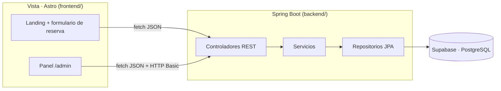

# Sakura · Gestión de pedidos y reservas para restaurante

Sistema de gestión de pedidos para un restaurante japonés (ficticio): menú con categorías y productos, mesas, pedidos
con detalle y total automático, usuarios con roles (Administrador, Mesero, Cliente) y, como extra, una landing con
**recorrido por el local que avanza con el scroll** y **reservas online**.

Proyecto de clase de **Desarrollo de Aplicaciones Empresariales** (UTS, II-2026). Arquitectura de 3 capas / MVC:
**Spring Boot** (API REST), **PostgreSQL en Supabase** y frontend en **Astro** (JavaScript/TypeScript).
Requerimientos y justificación: documento del Sprint 1.

## Equipo

| Integrante | Módulo | CRUD |
|---|---|---|
| Johann Sebastian Castellanos Prada ([@sebastiancastellanos3](https://github.com/sebastiancastellanos3)) | Mesas, pedidos, usuarios y reservas | Mesas, Pedidos (con detalle), Usuarios |
| Angel Santiago Jaimes Moreno ([@angelsantiagoa2j2](https://github.com/angelsantiagoa2j2)) | Menú | Categorías, Productos |

Las historias de usuario están en los **Issues** del repositorio y en el tablero del **Project**, y resumidas en
[`docs/historias-de-usuario.md`](docs/historias-de-usuario.md).

## Arquitectura



| Capa MVC | Dónde | Qué hace |
|---|---|---|
| **Modelo** | `backend/src/main/java/com/sakura/model`, `repository` | Entidades JPA y acceso a datos |
| **Controlador** | `backend/src/main/java/com/sakura/controller`, `service` | API REST y reglas de negocio |
| **Vista** | `frontend/src` | Páginas Astro que consumen la API |

```text
sakura/
├── backend/                 Spring Boot 4.1 · Java 21
│   └── src/main/java/com/sakura/
│       ├── model/           Usuario, Categoria, Producto, Mesa, Pedido, DetallePedido, Reserva, Turno…
│       ├── repository/      Spring Data JPA
│       ├── service/         Un servicio por módulo (reglas de negocio y transacciones)
│       ├── controller/      Controladores REST públicos y /api/admin
│       ├── dto/             Peticiones y respuestas (records con validación)
│       ├── exception/       Errores de negocio y respuestas de error en JSON
│       └── config/          Seguridad (HTTP Basic en /api/admin), CORS y propiedades
├── frontend/                Astro 7 · Tailwind 4 · GSAP · Lenis
│   └── src/
│       ├── pages/           index (landing) y panel /admin
│       ├── components/      Secciones de la landing y marco del panel
│       ├── scripts/         Recorrido con scroll, formulario de reserva, panel
│       └── lib/api.ts       Cliente de la API
├── database/supabase.sql    Esquema, seguridad y datos de ejemplo
└── docs/                    Diseño de la base de datos e historias de usuario
```

## Base de datos

Diseño completo y diagrama entidad-relación en [`docs/base-de-datos.md`](docs/base-de-datos.md).

Para crearla en Supabase: **SQL Editor → New query**, pega [`database/supabase.sql`](database/supabase.sql) y **Run**.

## Puesta en marcha

Necesitas **Java 21+** y **Node 22+**.

### 1. Backend (puerto 8080)

```sh
cd backend
./mvnw spring-boot:run
```

Arranca con una base de datos H2 en memoria y datos de ejemplo, sin configurar nada. Para usar Supabase:

```sh
cp .env.example .env        # rellena la conexión del Session pooler (Supabase → Connect)
./mvnw spring-boot:run -Dspring-boot.run.profiles=supabase
```

### 2. Frontend (puerto 4321)

```sh
cd frontend
npm install
npm run dev
```

- Landing: http://localhost:4321
- Panel: http://localhost:4321/admin (admin@sakura.example / sakura123)
- Vídeos del recorrido (opcional): `sh scripts-dev/descargar-videos.sh`

## API

| Método | Ruta | Descripción | Acceso | HU |
|---|---|---|---|---|
| GET | `/api/menu` | Menú: categorías con productos disponibles | Público | HU-06 |
| POST | `/api/auth/registro` | Registro de cliente | Público | HU-07 |
| GET | `/api/auth/yo` | Usuario autenticado y su rol | Autenticado | HU-07 |
| CRUD | `/api/admin/categorias` | Categorías | Admin | HU-02 |
| CRUD | `/api/admin/productos` | Productos | Admin | HU-01 |
| CRUD | `/api/admin/mesas` | Mesas | Admin | HU-08 |
| CRUD | `/api/admin/usuarios` | Usuarios y roles | Admin | HU-07 |
| GET · POST | `/api/pedidos` | Pedidos de una mesa | Mesero / Admin | HU-03 |
| CRUD | `/api/pedidos/{id}/detalles` | Detalle del pedido, total automático | Mesero / Admin | HU-04 |
| GET | `/api/admin/pedidos` | Historial con filtros | Admin | HU-05 |
| GET | `/api/disponibilidad` | Horas libres para reservar | Público | HU-09 |
| POST · GET · DELETE | `/api/reservas` | Reservas online | Público | HU-09 |
| GET · PATCH | `/api/admin/reservas` | Reservas del día | Admin | HU-09 |

Autenticación: HTTP Basic con email y contraseña de la tabla `usuario`. Los errores siempre responden
`{ "mensaje": "...", "campos": { "campo": "error" } }`.

## Usuarios de prueba

Los crea `database/supabase.sql` (y `data-local.sql` en local). Las contraseñas se guardan cifradas con BCrypt.

| Rol | Email | Contraseña | Puede |
|---|---|---|---|
| Administrador | `admin@sakura.example` | `sakura123` | Todo el panel: menú, mesas, usuarios, historial, reservas y pedidos |
| Mesero | `mesero@sakura.example` | `mesero123` | Pantalla `/mesero`: abrir pedidos, añadir productos, cambiar estado y cobrar |
| Cliente | `cliente@sakura.example` | `cliente123` | Ver y modificar solo sus pedidos; cancelarlos mientras están pendientes |

Los clientes nuevos se registran con `POST /api/auth/registro`; meseros y administradores los crea un administrador
en `/admin/usuarios`.

## Pantallas

| Ruta | Para | Qué hace |
|---|---|---|
| `/` | Clientes | Landing, menú disponible y reservas |
| `/mesero` | Mesero / Admin | Mesas con su estado y pedido de cada mesa con total automático |
| `/admin/mesas` | Admin | CRUD de mesas |
| `/admin/historial` | Admin | Historial de pedidos con filtros y ventas pagadas |
| `/admin/usuarios` | Admin | CRUD de usuarios y roles |
| `/admin` | Admin | Reservas del día |

## Reglas de negocio principales

- El total del pedido es siempre la suma de los subtotales del detalle; el precio se copia del producto al añadirlo.
- La mesa pasa a OCUPADA al abrir un pedido y vuelve a DISPONIBLE al pagarlo o cancelarlo.
- No se borra una categoría con productos ni un producto que ya está en pedidos (se marca como no disponible).

## Reglas de las reservas

- De 1 a 8 personas, desde hoy hasta 60 días después, nunca en días de cierre ni en horas ya pasadas.
- Cada turno tiene una capacidad máxima de personas; la comprobación y el guardado se hacen en una transacción con
  bloqueo del turno para que dos clientes no ocupen a la vez el último hueco.
- El cliente recibe un código `SAK-XXXX`. Para consultar o cancelar necesita el código **y** su email.

## Gestión del proyecto con GitHub

- **Issues**: una por historia de usuario, con criterios de aceptación y etiquetas por módulo.
- **Project**: tablero *Por hacer → En progreso → Hecho*.
- **Ramas**: `main` estable y una rama por módulo (`feature/menu-crud`, `feature/pedidos`), integradas con Pull Request.
- **Ambientes**: desarrollo con el perfil `local` (H2 en memoria) y producción con el perfil `supabase` (RNF-05).

## Créditos

- Recorrido con scroll, vídeos y fuentes basados en [midudev/mcp-higgsfield-landing](https://github.com/midudev/mcp-higgsfield-landing).
  Los vídeos muestran otro restaurante y se usan solo con fines académicos.
- Fuentes Hina Mincho y Zen Kaku Gothic New, licencia SIL OFL.
- Fotos del menú de [Unsplash](https://unsplash.com/license) (licencia Unsplash), optimizadas a WebP de 800 y 400 px
  en `frontend/public/menu/`:
  [nigiri](https://unsplash.com/photos/0GLzjcRBJQ8) (MChe Lee),
  [sashimi](https://unsplash.com/photos/moRC8S5K8AM) (Bundo Kim),
  [uramaki](https://unsplash.com/photos/-1GEAA8q3wk) (Vinicius Benedit),
  [gyozas](https://unsplash.com/photos/q66grqqHpDQ) (Pooja Chaudhary),
  [teppanyaki](https://unsplash.com/photos/dzEirdooEiM),
  [mochi](https://unsplash.com/photos/IWELEWFpufI) (Mattia Occhi),
  [miso](https://unsplash.com/photos/Mk3NKQboQkA) (Seiya Maeda),
  [té verde](https://unsplash.com/photos/zZ-QFv9auxg) (Yu Kato).
