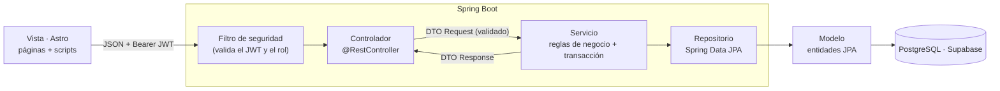
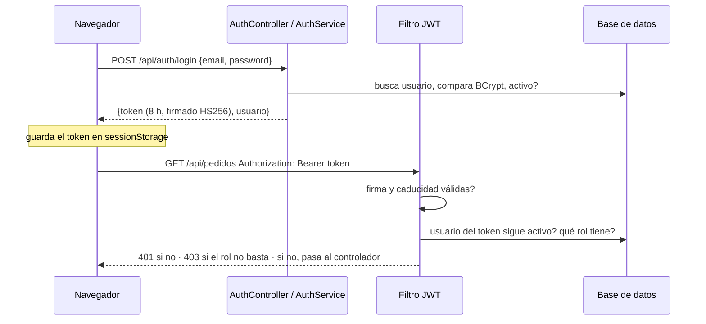

# Arquitectura y diseño

## Capas (MVC sobre una API REST)

| Capa | Paquete | Responsabilidad | No debe |
|---|---|---|---|
| Vista | `frontend/src` | Pintar datos y enviar formularios | Decidir permisos o precios (el servidor manda) |
| Controlador | `controller` | Traducir HTTP ↔ Java: ruta, verbo, código de estado | Tener reglas de negocio |
| DTO | `dto` | Forma de lo que entra (con validación) y lo que sale | Exponer contraseñas o entidades |
| Servicio | `service` | Reglas de negocio, permisos por dueño, transacciones y bloqueos | Saber de HTTP salvo por `ApiException` |
| Repositorio | `repository` | Consultas a la base | Tener lógica |
| Modelo | `model` | Entidades y sus invariantes (p. ej. `Pedido.recalcularTotal`) | Depender de capas de arriba |
| Errores | `exception` | Un único formato `{mensaje, campos}` para todos los errores | — |
| Config | `config` | Seguridad JWT, CORS, reloj, propiedades `sakura.*` | — |

## Autenticación con JWT

Decisiones:

- **Librería**: la de Spring Security (`oauth2-resource-server` + Nimbus), sin dependencias de terceros.
- **Qué lleva el token**: el email (`sub`), la fecha de caducidad y el rol solo como información para el frontend.
- **El rol se lee de la base en cada petición**: un usuario desactivado o al que se le quita un rol pierde el acceso
  al instante, sin esperar a que caduque su token. Cuesta una consulta por petición, que los servicios ya hacían.
- **Secreto** en `JWT_SECRET` (`.env`, fuera de Git). El perfil `supabase` no arranca sin él.
- **Sin sesiones en el servidor** (`STATELESS`) y por eso sin CSRF: el token viaja en una cabecera, no en una cookie.

## Revisión del código (noviembre 2026)

### Corregido en esta revisión

| Hallazgo | Tipo | Arreglo |
|---|---|---|
| HTTP Basic: el navegador guardaba **email y contraseña** en `sessionStorage` y los enviaba en cada petición | Seguridad | JWT: se guarda un token que caduca, nunca la contraseña |
| Reactivar una reserva **cancelada** no comprobaba el cupo del turno: se podía pasar de 20 personas | Lógica | `ReservaService.cambiarEstado` comprueba plazas con el turno bloqueado. Test `reactivarUnaReservaCanceladaRespetaElCupoDelTurno` |
| "Pedido cerrado" (PAGADO/CANCELADO) definido tres veces (`EstadoPedido`, `PedidoService`, `MesaService`) | Redundancia | Una sola definición: `EstadoPedido.CERRADOS` |
| `vacioANull` copiado en cinco servicios | Redundancia | Una sola copia en `service/Textos` |
| Comentarios y README hablaban de HTTP Basic | Documentación | Actualizados |
| Issue #21: los endpoints no tenían pruebas por HTTP | Pruebas | `CrudEndpointsTests` y `SeguridadJwtTests` |

### Corregido en la segunda revisión (Issue #41)

| Hallazgo | Arreglo |
|---|---|
| `Categoria` y `Producto` devolvían entidades y el controlador las convertía; `ProductoService` tenía que "tocar" la categoría a mano para que no fallara la carga perezosa | **Convención única**: el servicio devuelve DTO, armado dentro de la transacción. Única excepción: `Reserva`, porque el mismo dato tiene dos vistas (cliente y admin) y la elige el controlador |
| `ContenidoController` devolvía las entidades `Experiencia` y `Faq` | `ExperienciaResponse` y `FaqResponse` |
| `ApiException.noEncontrada()` tenía un mensaje de reservas en una clase genérica | Movido a `ReservaService` |
| Diagramas: BOM y bloque sin cerrar en casos de uso; faltaban `Reserva`, `Turno`, `Cierre` | Corregidos y completados (reservas, mesas, usuarios, historial, visitante) |

### Pendiente (decisión consciente, no es un fallo)

| Tema | Por qué se deja así | Si la app saliera a producción |
|---|---|---|
| Token en `sessionStorage`: un script inyectado (XSS) podría leerlo | Caduca en 8 h, nunca expone la contraseña y las vistas escapan el texto con `escapar()` | Cookie `HttpOnly` + CSRF |
| Las reservas son públicas y el email no se verifica: alguien podría reservar con emails inventados | Es una práctica de clase; ya hay una reserva por email y día, y el admin ve y cancela | Enviar un correo de confirmación (pasar de `PENDIENTE` a `CONFIRMADA` al hacer clic) y limitar peticiones por IP |
| El cliente elige mesa desde el móvil sin probar que está sentado en ella | Con un pedido por cliente el daño es una mesa, y el mesero puede cancelarlo | Código QR en cada mesa con un código que el cliente escanea |
| Una mesa con pedidos en el historial no se puede borrar | Así no se pierden las ventas | Campo `activa` para retirarla sin borrarla |

## ¿Tiene sentido como app? (análisis de la lógica)

Se recorrió el día de un restaurante con los tres roles y un visitante. El modelo es coherente: **la carta** (categorías
→ productos), **la sala** (mesas con estado), **el servicio** (pedido → detalle con precio copiado y total
automático → cocina → servido → cobrado) y **las reservas** (turnos con cupo → mesa asignada → la mesa sale
"reservada" desde 30 min antes). Cada rol tiene su pantalla y el servidor, no el navegador, decide los permisos.

Fallos de lógica que aparecieron al recorrerlo, y cómo quedaron (cada uno con su prueba en `MesasReservadasTests`):

| Escenario real | Qué pasaba | Ahora |
|---|---|---|
| Un cliente abre pedido en la mesa 1 y luego en la 2, 3… (incluso desde casa) | Bloqueaba mesas; además `/mi-pedido` solo muestra uno, los otros quedaban invisibles | **Un pedido abierto por cliente**. El mesero sigue atendiendo varias mesas |
| Llega el cliente que reservó y quiere pedir desde su móvil | Su propia mesa le salía "reservada" y no podía | Si la reserva es de **su email**, la mesa le aparece libre, la usa y la reserva pasa a ATENDIDA |
| A las 19:50 alguien reserva para las 20:00 | Se le podía asignar una mesa con gente comiendo | Si la reserva empieza antes de 2 h, **no se asignan mesas ocupadas** |
| Doble clic en "Reservar" o reservar varias horas "por si acaso" | Se creaban reservas repetidas que gastaban mesas y cupo | **Una reserva activa por email y día** (cancelando la primera se puede hacer otra) |
| El admin reactiva una reserva cancelada | Podía pasarse del cupo del turno | Comprueba el cupo (primera revisión) |

Lo que ya estaba bien y se mantiene: bloqueo de mesa y de turno contra dobles reservas o pedidos simultáneos, el
cliente solo ve sus pedidos (y recibe 404, no 403, en los ajenos), contraseñas con BCrypt, reloj inyectable para
probar reglas de horario, validación en los DTO y un único formato de error.

## Por qué Astro y no React

El enunciado pide React. Se mantiene Astro porque el frontend ya está terminado y probado, y Astro cumple el mismo
papel de capa **Vista** en el MVC: componentes, rutas por archivo y TypeScript, consumiendo la misma API REST.
La landing es casi toda contenido estático (Astro la entrega como HTML sin JavaScript de más) y las pantallas con
estado (`/mesero`, `/mi-pedido`, `/admin/*`) usan scripts TypeScript. Si se exigiera React, Astro permite añadir
componentes React (`@astrojs/react`) pantalla por pantalla sin rehacer el resto.
