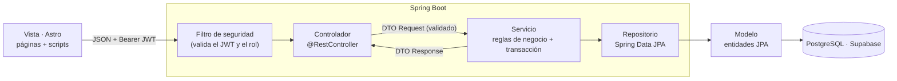
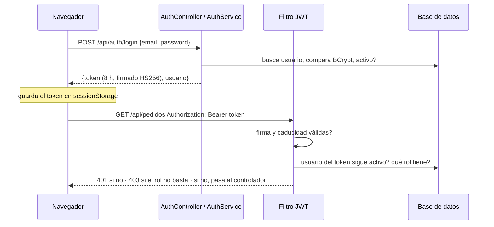

# Arquitectura y diseño

## Capas (MVC sobre una API REST)

| Capa | Paquete | Responsabilidad | No debe |
|---|---|---|---|
| Vista | `frontend/src` | Pintar datos y enviar formularios | Decidir permisos o precios (el servidor manda) |
| Controlador | `controller` | Traducir HTTP ↔ Java: ruta, verbo, código de estado | Tener reglas de negocio |
| DTO | `dto` | Forma de lo que entra (con validación) y lo que sale | Exponer contraseñas o entidades |
| Servicio | `service` | Reglas de negocio, permisos por dueño, transacciones y bloqueos | Saber de HTTP salvo por `ApiException` |
| Repositorio | `repository` | Consultas a la base | Tener lógica |
| Modelo | `model` | Entidades y sus invariantes (p. ej. `Pedido.recalcularTotal`) | Depender de capas de arriba |
| Errores | `exception` | Un único formato `{mensaje, campos}` para todos los errores | — |
| Config | `config` | Seguridad JWT, CORS, reloj, propiedades `sakura.*` | — |

## Autenticación con JWT

Decisiones:

- **Librería**: la de Spring Security (`oauth2-resource-server` + Nimbus), sin dependencias de terceros.
- **Qué lleva el token**: el email (`sub`), la fecha de caducidad y el rol solo como información para el frontend.
- **El rol se lee de la base en cada petición**: un usuario desactivado o al que se le quita un rol pierde el acceso
  al instante, sin esperar a que caduque su token. Cuesta una consulta por petición, que los servicios ya hacían.
- **Secreto** en `JWT_SECRET` (`.env`, fuera de Git). El perfil `supabase` no arranca sin él.
- **Sin sesiones en el servidor** (`STATELESS`) y por eso sin CSRF: el token viaja en una cabecera, no en una cookie.

## Revisión del código (noviembre 2026)

### Corregido en esta revisión

| Hallazgo | Tipo | Arreglo |
|---|---|---|
| HTTP Basic: el navegador guardaba **email y contraseña** en `sessionStorage` y los enviaba en cada petición | Seguridad | JWT: se guarda un token que caduca, nunca la contraseña |
| Reactivar una reserva **cancelada** no comprobaba el cupo del turno: se podía pasar de 20 personas | Lógica | `ReservaService.cambiarEstado` comprueba plazas con el turno bloqueado. Test `reactivarUnaReservaCanceladaRespetaElCupoDelTurno` |
| "Pedido cerrado" (PAGADO/CANCELADO) definido tres veces (`EstadoPedido`, `PedidoService`, `MesaService`) | Redundancia | Una sola definición: `EstadoPedido.CERRADOS` |
| `vacioANull` copiado en cinco servicios | Redundancia | Una sola copia en `service/Textos` |
| Comentarios y README hablaban de HTTP Basic | Documentación | Actualizados |
| Issue #21: los endpoints no tenían pruebas por HTTP | Pruebas | `CrudEndpointsTests` y `SeguridadJwtTests` |

### Pendiente (no rompe nada; para un siguiente sprint)

| Hallazgo | Por qué importa | Propuesta |
|---|---|---|
| Unos servicios devuelven DTO (`Mesa`, `Usuario`, `Pedido`) y otros entidades (`Categoria`, `Producto`, `Reserva`) que el controlador convierte | Dos convenciones para lo mismo | Elegir una: que todos los servicios devuelvan DTO |
| `ContenidoController` devuelve las entidades `Experiencia` y `Faq` tal cual | Cambiar la tabla cambia la API sin querer | Añadir `ExperienciaResponse` y `FaqResponse` |
| `ApiException.noEncontrada()` tiene un mensaje de reservas en una clase genérica | Confunde si se usa en otro módulo | Moverlo a `ReservaService` |
| El token en `sessionStorage` lo puede leer un script inyectado (XSS) | El daño queda limitado a 8 h y nunca expone la contraseña; las vistas ya escapan el texto con `escapar()` | Si se publica en Internet: cookie `HttpOnly` + CSRF |
| Diagramas de Angel (`docs/casos-de-uso.md` sin cierre de bloque y con BOM; faltan `Reserva`, `Turno`, `Cierre` en `diagrama-de-clases.md`) | No se ven bien en GitHub | Que los corrija Angel desde su cuenta |

Lo que ya estaba bien y se mantiene: bloqueo de mesa y de turno contra dobles reservas o pedidos simultáneos, el
cliente solo ve sus pedidos (y recibe 404, no 403, en los ajenos), contraseñas con BCrypt, reloj inyectable para
probar reglas de horario, validación en los DTO y un único formato de error.

## Por qué Astro y no React

El enunciado pide React. Se mantiene Astro porque el frontend ya está terminado y probado, y Astro cumple el mismo
papel de capa **Vista** en el MVC: componentes, rutas por archivo y TypeScript, consumiendo la misma API REST.
La landing es casi toda contenido estático (Astro la entrega como HTML sin JavaScript de más) y las pantallas con
estado (`/mesero`, `/mi-pedido`, `/admin/*`) usan scripts TypeScript. Si se exigiera React, Astro permite añadir
componentes React (`@astrojs/react`) pantalla por pantalla sin rehacer el resto.
