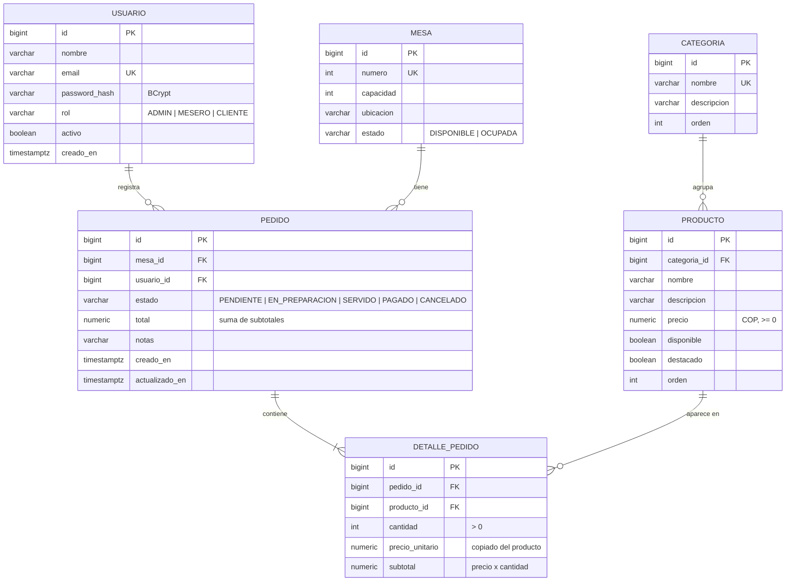
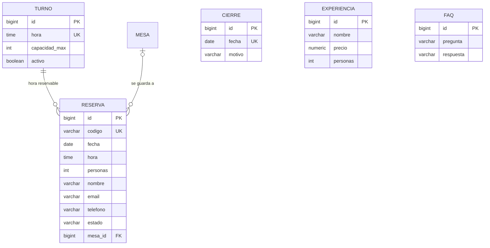
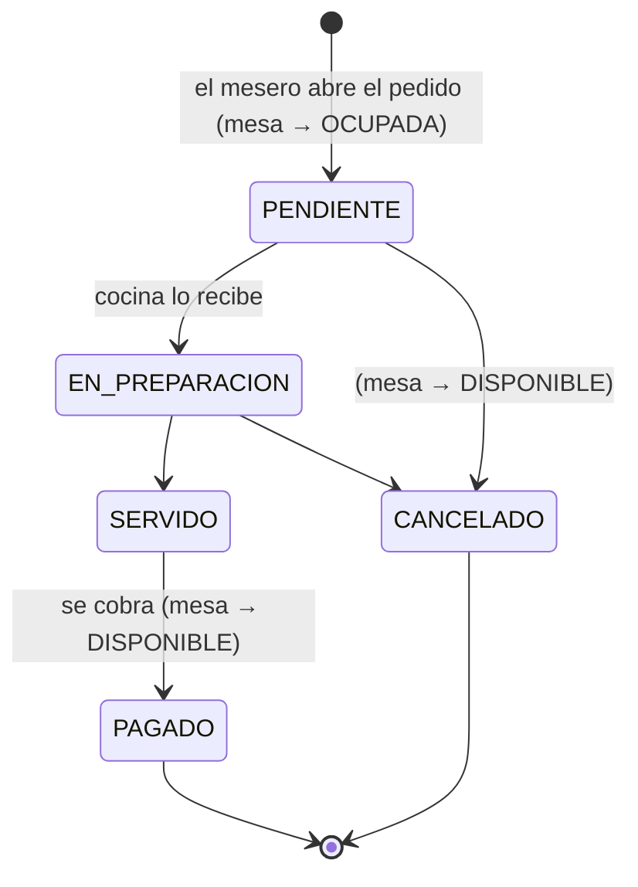

# Diseño de la base de datos

Base de datos **PostgreSQL** alojada en **Supabase**. El script completo (tablas, restricciones, seguridad y datos de
ejemplo) está en [`database/supabase.sql`](../database/supabase.sql). En local, el backend usa H2 en modo PostgreSQL con
el mismo modelo (`backend/src/main/resources/data-local.sql`).

## Diagrama entidad-relación

Además, el módulo de **reservas** de la landing usa tablas independientes:

## Tablas

| Tabla | Para qué sirve | Requerimientos | Responsable del CRUD |
|---|---|---|---|
| `usuario` | Usuarios con su rol | RF-08, RF-11 | Sebastián |
| `categoria` | Categorías del menú | RF-02 | Angel |
| `producto` | Productos del menú | RF-01, RF-10 | Angel |
| `mesa` | Mesas y su estado | RF-07 | Sebastián |
| `pedido` | Pedidos asociados a una mesa | RF-03, RF-06, RF-09 | Sebastián |
| `detalle_pedido` | Productos de cada pedido | RF-04, RF-05 | Sebastián |
| `turno`, `cierre`, `reserva` | Reservas online (extra) | — | Sebastián |
| `experiencia`, `faq` | Contenido de la landing | — | — |

## Reglas y restricciones

| Regla | Dónde se aplica |
|---|---|
| `usuario.email`, `categoria.nombre` y `mesa.numero` son únicos | BD (`unique`) + servicio (mensaje 409 claro) |
| `producto.categoria_id` debe existir; no se borra una categoría con productos | BD (`references … on delete restrict`) + `CategoriaService` |
| Un producto que ya está en pedidos no se borra: se marca como no disponible | BD (`on delete restrict`) + `ProductoService` |
| Precios y cantidades no negativos | BD (`check`) + `@Valid` en los DTO |
| El precio del detalle se copia del producto al añadirlo | `DetallePedido` (el pedido no cambia si cambia la carta) |
| `pedido.total` = suma de `detalle_pedido.subtotal` | `Pedido.recalcularTotal()` tras cada cambio del detalle (RF-05) |
| Un mismo producto aparece una sola vez por pedido (se suma la cantidad) | BD (`unique (pedido_id, producto_id)`) |
| La mesa pasa a OCUPADA al abrir un pedido y a DISPONIBLE al pagarlo o cancelarlo | `PedidoService` (HU-08) |
| Cada reserva recibe la mesa libre más pequeña donde caben; una mesa no se reserva dos veces a menos de 2 horas | `ReservaService` |
| La mesa sale "reservada" desde 30 min antes hasta 15 min después de la hora; el cliente no ve la hora ni puede pedir en ella | `ReservaService`, `MesaController`, `PedidoService` |
| Si el personal abre un pedido en una mesa reservada, la reserva pasa a ATENDIDA | `PedidoService` |
| Borrar un pedido borra su detalle | BD (`on delete cascade`) |
| Solo ADMIN accede a `/api/admin/**` | `SecurityConfig` (RF-11) |

## Seguridad en Supabase

Supabase expone las tablas de `public` en su API REST. El script activa **Row Level Security** en todas y no crea
políticas, así que esa API no puede leer ni escribir nada. Todo el acceso pasa por el backend Spring, que conecta con el
rol `postgres` (dueño de las tablas) y no se ve afectado por RLS. Las contraseñas se guardan cifradas con BCrypt.

## Estados de un pedido

## Usuarios de prueba

| Email | Contraseña | Rol |
|---|---|---|
| admin@sakura.example | sakura123 | ADMIN |
| mesero@sakura.example | mesero123 | MESERO |
| cliente@sakura.example | cliente123 | CLIENTE |
