# Diagrama de casos de uso - Sakura

```mermaid
flowchart TB
    Admin["Administrador"]
    Mesero["Mesero"]
    Cliente["Cliente"]
    Visitante["Visitante (sin cuenta)"]

    subgraph Sistema["Sistema Sakura"]
        UC1(["Iniciar sesión"])
        UC2(["Gestionar categorías"])
        UC3(["Gestionar productos"])
        UC4(["Consultar menú"])
        UC5(["Consultar pedidos"])
        UC6(["Gestionar pedidos"])
        UC7(["Registrar pedidos"])
        UC8(["Consultar estado del pedido"])
        UC9(["Reservar, consultar o cancelar reserva"])
        UC10(["Registrarse como cliente"])
        UC11(["Gestionar mesas"])
        UC12(["Gestionar usuarios y roles"])
        UC13(["Consultar historial y ventas"])
        UC14(["Gestionar reservas del día"])
    end

    Admin --- UC1
    Admin --- UC2
    Admin --- UC3
    Admin --- UC4
    Admin --- UC5
    Admin --- UC6

    Mesero --- UC1
    Mesero --- UC4
    Mesero --- UC5
    Mesero --- UC6
    Mesero --- UC7

    Cliente --- UC4
    Cliente --- UC8
    Cliente --- UC7
    Cliente --- UC1
    Cliente --- UC9

    Visitante --- UC4
    Visitante --- UC9
    Visitante --- UC10

    Admin --- UC11
    Admin --- UC12
    Admin --- UC13
    Admin --- UC14
```

Reglas que limitan los casos de uso:

- **UC7 (cliente)**: un solo pedido abierto a la vez; no puede usar una mesa reservada salvo que la reserva sea suya
  (mismo email que su cuenta).
- **UC9**: una reserva activa por email y día; se consulta o cancela con el código `SAK-XXXX` y el email.
