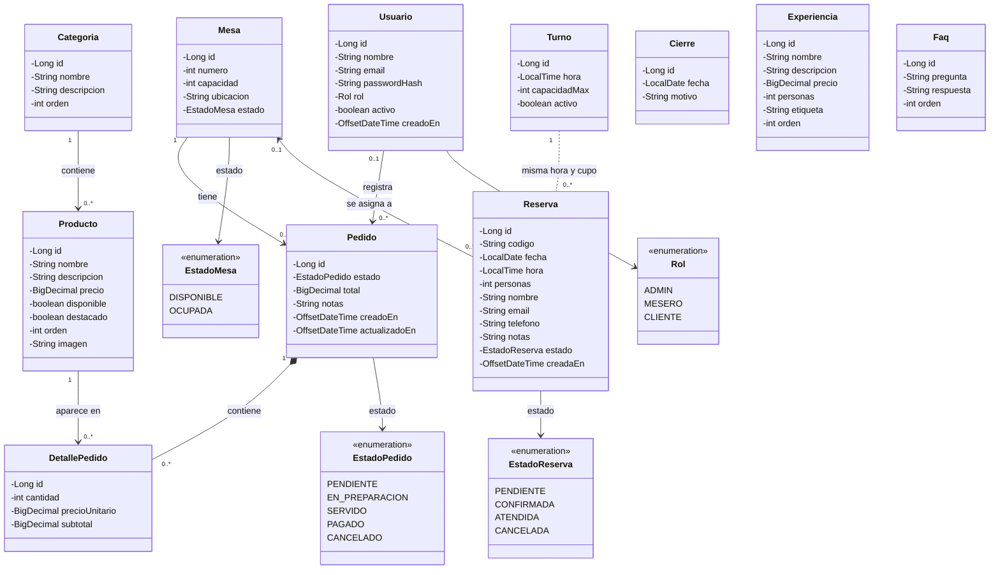

# Diagrama de clases - Sakura

`Turno` y `Reserva` se relacionan por la hora (no hay clave foránea): el turno marca cuántas personas caben a esa hora.
`Cierre` son los días sin servicio. `Experiencia` y `Faq` son contenido de la landing.
